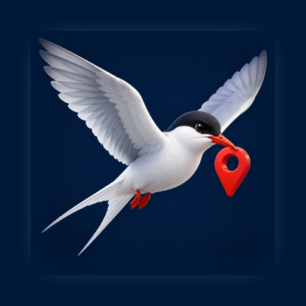

<p align="center">
  
</p>

# Tern

**Move your iPhone anywhere on the map, from your Mac. Free for personal use, source available, no account, no jailbreak.**

Tern is a macOS app that simulates the location of an iPhone connected over USB. Teleport to a point, drive or walk a
route that follows real roads, steer with a joystick, or replay a GPX track. It uses the same developer location
channel that Xcode uses, wrapped in a CarPlay-style interface.

[Türkçe açıklama aşağıda.](#türkçe)


## Features

- **Teleport** – click the map or search an address, press Go.
- **Route** – pick stops on the map; Tern asks Apple Maps for the road route (driving or walking), with
  *avoid tolls* and *avoid highways* options, round trips and loops.
- **Traffic pace** – follow Apple's travel-time estimate, which includes live traffic, instead of a fixed speed.
- **Joystick** – drag a knob or use the arrow keys to walk around freely.
- **GPX** – open any GPX file and play it back at the speed you choose.
- **Speed** – walk, bike and car presets, a slider up to 216 km/h, and a "realistic pace" option that varies the
  speed a little so the trace does not look machine-made.
- **Favorites and recents** – star places you return to.
- **No root, no jailbreak** – iOS 17 and later use a userspace tunnel, so Tern never asks for your password.
- **iOS 16 and earlier** – Tern downloads and mounts the developer disk image for you.
- English and Turkish.

## Requirements

- macOS 15 or later (Apple silicon or Intel).
- An iPhone or iPad with **Developer Mode** on (Settings → Privacy & Security → Developer Mode).
- A USB cable for the first connection. Tap *Trust* on the phone when asked.

## Install

Download the latest `Tern.dmg` from [Releases](https://github.com/Voxyfy/tern/releases), drag Tern to Applications,
open it, plug in the phone and press **Connect**.

Tern is distributed outside the Mac App Store because the sandbox does not allow talking to the device over
usbmuxd. The app is signed and notarized.

## How it works

Tern.app is a SwiftUI application. Everything that touches the phone happens in a small Go helper, `ternd`,
built on [go-ios](https://github.com/danielpaulus/go-ios):

1. `ternd` lists devices through usbmuxd.
2. On iOS 17+ it opens a userspace tunnel to the device (Apple's RemoteXPC transport), discovers the
   `instruments` service through Remote Service Discovery and opens the `LocationSimulation` channel.
   That channel must stay open for the simulated location to persist, which is why Tern keeps the helper alive
   instead of spawning a CLI per update.
3. On iOS 16 and earlier it mounts the developer disk image and uses `com.apple.dt.simulatelocation`.
4. The app sends coordinates once per second while a route plays. Routes come from MapKit directions, so
   they follow real roads, and MapKit's travel-time estimate can set the pace.

Stop, disconnect or quit, and the phone goes back to its real location.

## Build from source

```sh
brew install xcodegen go
git clone https://github.com/Voxyfy/tern.git && cd tern
sh scripts/run-dev.sh        # builds ternd, generates the Xcode project, builds and launches Tern
```

`scripts/build-ternd.sh` builds the universal helper into `ternd/bin/ternd`, which Xcode copies into
`Tern.app/Contents/MacOS`. Tests: `xcodebuild -project Tern.xcodeproj -scheme Tern test`.

## Fair use

Simulating your location breaks the rules of many games and dating apps, and they do ban accounts for it. Tern
is a developer and testing tool; what you do with it is on you.

## Icon

The app icon is an Arctic tern carrying a map pin, in the same 3D mascot style as the other Voxyfy apps.
The 1024 px source lives in `design/icon-source.png`; the Icon Composer bundle is `Tern/Resources/AppIcon.icon`.

| App icon | In the Dock |
|---|---|
|  |  |

## License

[PolyForm Noncommercial 1.0.0](LICENSE). Personal, research, educational and other noncommercial use is free,
including changes and redistribution under the same terms. Commercial use needs a separate license: write to
[haymana.batuhan@gmail.com](mailto:haymana.batuhan@gmail.com). Third-party components keep their own licenses, see
[THIRD_PARTY.md](THIRD_PARTY.md).

---

## Türkçe

**iPhone'unuzu Mac'ten haritada istediğiniz yere taşıyın. Kişisel kullanımda ücretsiz, kaynağı açık, hesap yok, jailbreak yok.**

Tern, USB ile bağlı bir iPhone'un konumunu simüle eden bir macOS uygulamasıdır. Bir noktaya ışınlanın, gerçek
yolları izleyen bir rotada sürün ya da yürüyün, joystick ile dolaşın veya bir GPX kaydını oynatın. Xcode'un
kullandığı geliştirici konum kanalını, CarPlay tarzı bir arayüzle kullanır.

### Özellikler

- **Işınlan** – haritaya tıklayın ya da adres arayın, Git'e basın.
- **Rota** – haritada duraklar seçin; Tern yol tarifini Apple Haritalar'dan alır (araba ya da yürüyüş),
  *ücretli yollardan kaçın* ve *otoyollardan kaçın* seçenekleri, gidiş-dönüş ve tekrar sayısı vardır.
- **Trafik hızı** – sabit hız yerine Apple'ın canlı trafiği içeren varış süresi tahminine uyun.
- **Joystick** – topuzu sürükleyin ya da ok tuşlarıyla serbestçe yürüyün.
- **GPX** – herhangi bir GPX dosyasını açın, seçtiğiniz hızda oynatın.
- **Hız** – yürüme, bisiklet ve araba ön ayarları, 216 km/sa'ye kadar kaydırıcı ve izi makine işi gibi
  göstermeyen "gerçekçi tempo" seçeneği.
- **Favoriler ve son yerler** – döndüğünüz yerleri yıldızlayın.
- **Yetki istemez, jailbreak gerekmez** – iOS 17 ve üstünde kullanıcı alanı tüneli kullanılır, Tern şifrenizi
  hiç sormaz.
- **iOS 16 ve altı** – geliştirici disk imajını Tern sizin için indirip bağlar.
- İngilizce ve Türkçe.

### Gereksinimler

- macOS 15 ya da üstü (Apple silicon ya da Intel).
- **Geliştirici Modu** açık bir iPhone ya da iPad (Ayarlar → Gizlilik ve Güvenlik → Geliştirici Modu).
- İlk bağlantı için USB kablosu. Telefon sorduğunda *Güven*'e dokunun.

### Kurulum

[Releases](https://github.com/Voxyfy/tern/releases) sayfasından `Tern.dmg` dosyasını indirin, Tern'i Uygulamalar
klasörüne sürükleyin, açın, telefonu takın ve **Bağlan**'a basın.

Tern Mac App Store dışından dağıtılır; sandbox, cihazla usbmuxd üstünden konuşmaya izin vermez. Uygulama
imzalı ve noterlidir.

### Nasıl çalışır

Tern.app bir SwiftUI uygulamasıdır. Telefona dokunan her şey, [go-ios](https://github.com/danielpaulus/go-ios)
üstüne kurulu küçük bir Go yardımcısında (`ternd`) olur: cihazı usbmuxd ile bulur, iOS 17+ için kullanıcı
alanı tüneli açar, `instruments` servisindeki `LocationSimulation` kanalını açık tutar ve uygulamanın
gönderdiği koordinatları saniyede bir telefona iletir. Durdurun, bağlantıyı kesin ya da çıkın; telefon gerçek
konumuna döner.

### Adil kullanım

Konum simülasyonu birçok oyunun ve flört uygulamasının kurallarına aykırıdır ve hesap kapatma sebebidir. Tern bir
geliştirme ve test aracıdır; ne yaptığınız size kalmış.

### İkon

Uygulama ikonu, ağzında konum iğnesi taşıyan bir kutup sumrusu; diğer Voxyfy uygulamalarıyla aynı 3D maskot
dilinde. 1024 px kaynak `design/icon-source.png`, Icon Composer paketi `Tern/Resources/AppIcon.icon`.

### Lisans

[PolyForm Noncommercial 1.0.0](LICENSE). Kişisel, araştırma, eğitim ve diğer ticari olmayan kullanımlar ücretsizdir;
değiştirip aynı şartlarla dağıtabilirsiniz. Ticari kullanım ayrı izne tabidir:
[haymana.batuhan@gmail.com](mailto:haymana.batuhan@gmail.com). Üçüncü taraf bileşenler kendi lisanslarını korur, bkz.
[THIRD_PARTY.md](THIRD_PARTY.md).
